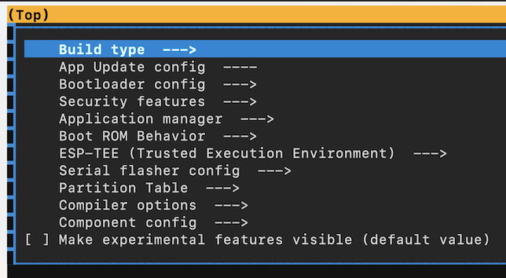
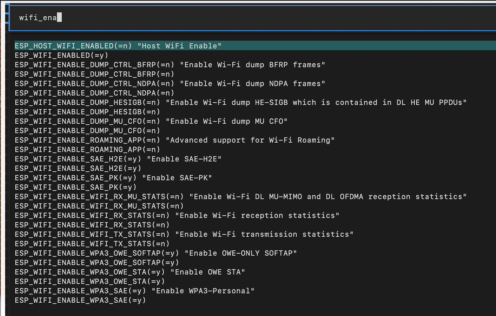
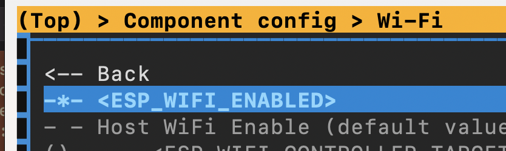
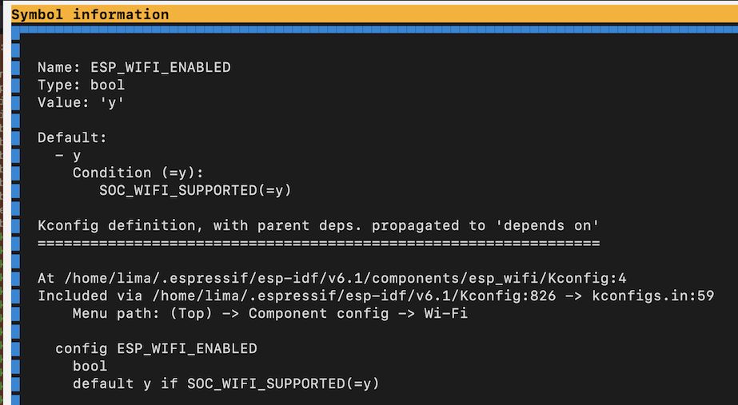

# Skinned

>See [`../Skinned.md`](../Skinned.md) for a reasoning.


## Requirements

- `just`

	`$ sudo apt install just`


## Steps

### Prep

```
$ git checkout skinned
$ cargo clean
```

### Build

```
$ cargo build --release -vv
```

### Find the `sdkconfig`

```
$ just sdkconfig-path
/home/lima/target/riscv32imac-esp-espidf/release/build/esp-idf-sys/8a69eb1ab64ce304/out/sdkconfig
```

```
$ cp `just sdkconfig-path` .
```

### Launch `menuconfig`

We can use the ESP-IDF tooling *already installed by `esp-idf-sys`* to study the `sdkconfig` produced by the build.

>🌟🌟🌟 Please study [`ezb-node/_mc/README.md](https://github.com/finalyards-org/ezb-node/blob/main/_mc/README.md) and return here...

<p />

>👉 Note that: 
>
>- We'll make all the manual wizardy within this `skinned` folder, not in the root. This avoids messing the Rust project.
>
>- Also, you will run a separate shell, meaning once you exit it the env.variables are gone. We do have a safety valve to remind you, if you were to try to build Rust while having the tools still manually available.


```
$ bash
```

```
$ export ESP_IDF_VERSION=6.1
```

#### If using a VM (skip otherwise)

Directing `build` and `managed_components` to a local Linux partition speeds up e.g. launch of `menuconfig`. 

```
$ install -d ~/.cache/skinned/build
$ ln -s ~/.cache/skinned/build .
```

```
$ install -d ~/.cache/skinned/managed_components
$ ln -s ~/.cache/skinned/managed_components .
```

#### ..continue here👇

```
$ idf.py set-target esp32c6
```

```
$ idf.py menuconfig
```

>**Hint!**
>
>The author finds it best to tune Terminal settings for the session running `idf.py menuconfig`:
>
>- different color scheme
>- **way bigger** font
>
>


## Using `menuconfig`

- `Component config`

- e.g. `/` + `WIFI`

	

You see that `ESP_WIFI_ENABLED(=y)`. 

- Press `Enter` while the cursor is on that line.

	

	That is *gray* (move the cursor to confirm).

Gray means we cannot change the setting.



The setting is `y` because of:

```
default y if SOC_WIFI_SUPPORTED(=y)
```

i.e. **"if the MCU supports WiFi, bring in that component"**.


## Can we disable it?

>TL;DR We cannot.

Switch to the Rust terminal you hopefully have open somewhere.

Add this to the `sdkconfig.defaults`:

```
CONFIG_ESP_WIFI_ENABLED=n
```

```
$ cargo clean
$ cargo build --release -vv
```

```
$ cd skinned
$ just sdkconfig-path
/home/lima/target/riscv32imac-esp-espidf/release/build/esp-idf-sys/8a69eb1ab64ce304/out/sdkconfig
```

>Note that the path is now different than on the earlier `sdkconfig`-creating build.

We don't need to open `menuconfig` for this. We can just:

```
$ cat `just sdkconfig-path` | grep ESP_WIFI_ENABLED
CONFIG_ESP_WIFI_ENABLED=y
```

The WiFi component remains in the build.


## Summary

Above, we learned how to use `idf.py menuconfig` on the `sdkconfig` produced by a Rust/Cargo build.

We checked, as an example, the presence of WiFi component in such a build.

The author aims to list at least some such components in this folder, see `report-6.1.md` (*name might change*).

>**Note:**
>
>To make sure, this is not a criticism to the existing ESP-IDF, or `esp-idf-{sys|svc}` approach. It makes perfect sense, legacy-wise, to have e.g. WiFi always on. Wifi has been the big selling point of the whole ESP32 family.
>
>But there are cases (the author's is a Zigbee + wired PoE device) where WiFi is.. unneeded. By mapping such defaults, and hopefully making them opt-in in future versions of the ESP-IDF framework, we can pave the way for a more versatile developer experience.


## References

- [`ezb-node/_mc`](https://github.com/finalyards-org/ezb-node/tree/main/_mc)

	Information about using an existing `~/.espressif` toolchain, manually, to run `idf.py menuconfig`.

